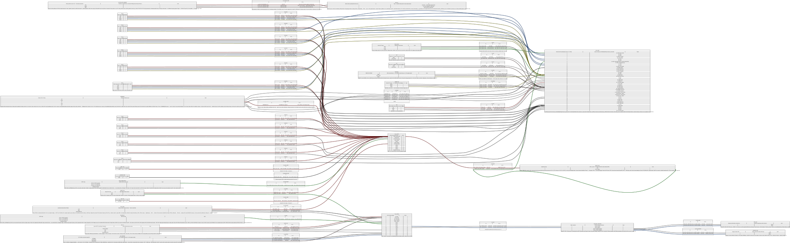
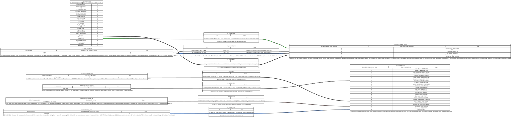
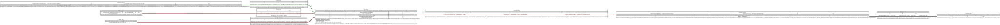

# e36-wiring

Version-controlled wiring harness documentation for an RHD E36 convertible restomod.
Engine: VW 07K 2.5L I5 (turbo, longitudinal) · ECU: MaxxECU Race · Trans: ZF 8HP70

Diagrams are authored in [WireViz](https://github.com/wireviz/WireViz) YAML format — plain text,
git-diffable, outputs SVG/PNG/HTML/BOM automatically.

> **Project plan:** System-level build decisions, parts sourcing, mechanical specs, and phase sequencing live in [`E36_9000RPM_Project_Plan_Verified.md`](https://github.com/wesleyxcooper/e36-build-docs/blob/main/E36_9000RPM_Project_Plan_Verified.md). This repo is the authoritative source for pin assignments, wire colors, connector part numbers, and harness routing — the project plan defers to the `.wv` files for all electrical detail.

## Document Conventions

**Engine lateral sides — always use exhaust/intake, never left/right or driver/passenger.**

Left/right and driver/passenger are LHD-centric and ambiguous in an RHD build. All references in this repo use:

| Term | Meaning |
| :--- | :--- |
| **Exhaust side** | Long side of 07K block with exhaust ports and primary OEM mount bosses |
| **Intake side** | Long side of 07K block with intake ports and oil filter housing |

**Engine longitudinal ends — always use cylinder 1 side / cylinder 5 side, never front/rear.**

Front/rear is ambiguous: in the OEM VW transverse installation "front" means the intake-facing side (a lateral direction in E36). All references in this repo use:

| Term | Meaning |
| :--- | :--- |
| **Cylinder 1 side** | End toward E36 radiator |
| **Cylinder 5 side** | End toward E36 firewall — timing chain / flywheel end in OEM VW (chain compartment at this end; TDC cyl 5 used for timing adj. — charm.li BGP service manual) |

**RHD E36 orientation summary (longitudinal, cylinder 1 side toward radiator):**

| Car position | 07K axis |
| :--- | :--- |
| Driver side (right) | **Exhaust side** — SPA manifold, turbo, downpipe, engine stand adapter |
| Passenger side (left) | **Intake side** — iABED housing, intake manifold |
| Toward radiator | **Cylinder 1 side** |
| Toward firewall | **Cylinder 5 side** — timing chain, crank sensor |

This applies to all harness routing notes, connector location descriptions, and loom routing docs in this repo.

## Diagrams

Click any link to view the interactive diagram with full BOM in your browser — no code checkout needed.

### Phase 1 — M52 baseline (NA M52 + 8HP + MaxxECU)

The M50 pre-terminated harness covers all M52 engine management signals (injectors, coils, crank, cam, MAP, IAT, CLT, TPS, VANOS, O2, ICV). Everything below is **supplemental wiring** — what you build or modify on top of the purchased harness.

PMU16 installs at Phase 1 alongside the MaxxECU H2O (see `power-distribution.wv`). No discrete relay board is built.

| Harness | Interactive HTML | Source |
|---|---|---|
| MaxxECU ↔ M52 signal reference (pre-terminated M50 harness — SIGNAL REF, do not build) | [maxxecu-m52.html](https://htmlpreview.github.io/?https://github.com/wesleyxcooper/e36-wiring/blob/main/output/maxxecu-m52.html) | `harnesses/maxxecu-m52.wv` |
| EWS2 chassis bypass | [ews2-bypass.html](https://htmlpreview.github.io/?https://github.com/wesleyxcooper/e36-wiring/blob/main/output/ews2-bypass.html) | `harnesses/ews2-bypass.wv` |
| Power distribution — Ecumaster PMU16 (Phase 1 install alongside MaxxECU H2O) | [power-distribution.html](https://htmlpreview.github.io/?https://github.com/wesleyxcooper/e36-wiring/blob/main/output/power-distribution.html) | `harnesses/power-distribution.wv` |
| Continental flex fuel sensor — Phase 1 | [flex-fuel-sensor-phase1.html](https://htmlpreview.github.io/?https://github.com/wesleyxcooper/e36-wiring/blob/main/output/flex-fuel-sensor-phase1.html) | `harnesses/flex-fuel-sensor-phase1.wv` |
| ZF 8HP70 TCU CAN + power (pre-made MaxxECU 8HP GEN1 kit) | [8hp-can.html](https://htmlpreview.github.io/?https://github.com/wesleyxcooper/e36-wiring/blob/main/output/8hp-can.html) | `harnesses/8hp-can.wv` |
| 8HP body integrations — PMU16 reverse light (Phase 1 — SUPERSEDED, see phase3 file) | [8hp-body-integrations-phase1.html](https://htmlpreview.github.io/?https://github.com/wesleyxcooper/e36-wiring/blob/main/output/8hp-body-integrations-phase1.html) | `harnesses/8hp-body-integrations-phase1.wv` |
| Gauge.S CAN cluster (cabin, 500 kbps, Default 1.3) | [gauge-s-can.html](https://htmlpreview.github.io/?https://github.com/wesleyxcooper/e36-wiring/blob/main/output/gauge-s-can.html) | `harnesses/gauge-s-can.wv` |
| DCT Shifter paddle → MaxxECU DIN (cabin-to-cabin, 3-wire) | [dct-shifter.html](https://htmlpreview.github.io/?https://github.com/wesleyxcooper/e36-wiring/blob/main/output/dct-shifter.html) | `harnesses/dct-shifter.wv` |
| E36 X20 body connector | [body-x20.html](https://htmlpreview.github.io/?https://github.com/wesleyxcooper/e36-wiring/blob/main/output/body-x20.html) | `harnesses/body-x20.wv` |
| Bosch PST-F1 oil temp+pressure (Phase 1: pigtail to M50 16-pin AUX breakout) | [pst-f1-sensor.html](https://htmlpreview.github.io/?https://github.com/wesleyxcooper/e36-wiring/blob/main/output/pst-f1-sensor.html) | `harnesses/pst-f1-sensor.wv` |
| ATF temp sensor — MaxxECU NTC 1/8 NPT, engine-bay direct-terminate *(optional)* | [atf-temp-sensor.html](https://htmlpreview.github.io/?https://github.com/wesleyxcooper/e36-wiring/blob/main/output/atf-temp-sensor.html) | `harnesses/atf-temp-sensor.wv` |
| EPowerSteering.com E36 column-assist EPS (cabin-only — PMU16 O8 power source) | [eps-column.html](https://htmlpreview.github.io/?https://github.com/wesleyxcooper/e36-wiring/blob/main/output/eps-column.html) | `harnesses/eps-column.wv` |
| Fuel pump hanger — discrete relay (SUPERSEDED — PMU16 O4 used instead) | [fuel-pump-hanger-phase1.html](https://htmlpreview.github.io/?https://github.com/wesleyxcooper/e36-wiring/blob/main/output/fuel-pump-hanger-phase1.html) | `harnesses/fuel-pump-hanger-phase1.wv` |

---

> **Build path branch point.** After Phase 1 the project diverges into two engine choices:
> - **Path A — Turbo M52B28 (Phases 2a → 3a):** Iron-block M52B28 built by VAC, turbo + 8HP, MaxxECU. Keeps the M50 pre-terminated harness; supplemental wiring only.
> - **Path B — VW 07K (Phases 2b → 3b):** Custom 07K 5-cyl harness, Maven bulkhead, PMU16, EWP, DBW throttle. Full harness replacement.

---

### Phase 2a — Turbo M52B28 offline prep (while VAC builds the engine)

The M50 pre-terminated harness stays installed. Everything here is a **delta from Phase 1** — only what changes or is added.

| Harness | Interactive HTML | Source |
|---|---|---|
| Turbo M52 supplemental — boost solenoid (GPO 1 BOOST_SOL stub), IAT2 charge temp sensor, reverse light reroute GPO 1 → GPO 8 | [m52-turbo-phase2a.html](https://htmlpreview.github.io/?https://github.com/wesleyxcooper/e36-wiring/blob/main/output/m52-turbo-phase2a.html) | `harnesses/m52-turbo-phase2a.wv` |

**GPO changes in Phase 2a:**

| GPO | Phase 1 | Phase 2a |
|---|---|---|
| GPO 1 (BOOST_SOL stub) | Reverse light relay coil low-side | Boost solenoid coil low-side |
| GPO 7/DIN3 (16-pin pin 5) | Flex fuel sensor — unchanged | Flex fuel sensor — unchanged |
| GPO 8/TACHO (16-pin pin 4) | Unused | Reverse light relay coil low-side |

**MAP sensor swap (no wiring change):** Swap OEM 1-bar MAP sensor → 3-bar absolute unit (JMT 1.5mm 3-pin housing `3B0973703G` — verify connector compatibility at purchase). MTune calibration update required. See `harnesses/m52-turbo-phase2a.wv` for sensor options.

### Phase 3a — Turbo M52B28 install day

The engine returns from VAC and replaces the NA M52. All Phase 2a wiring is pre-routed — this is a plug-in and configure operation.

| Harness | Interactive HTML | Source |
|---|---|---|
| Turbo M52 install day checklist — connections, MTune config, boost prevention, pre-tune steps | [m52-turbo-phase3a.html](https://htmlpreview.github.io/?https://github.com/wesleyxcooper/e36-wiring/blob/main/output/m52-turbo-phase3a.html) | `harnesses/m52-turbo-phase3a.wv` |

**At Phase 3a:** plug boost solenoid into BOOST_SOL stub, connect IAT2 at charge pipe, swap MAP sensor (component only), verify GPO 8 reverse light. FMIC outlet physically disconnected until Phase 4a dyno tune. See `19d-m5x-turbo-calibration.md` for the pre-tune safety checklist.

---

### Phase 2b — 07K harness build (offline bench build)

| Harness | Interactive HTML | Source |
|---|---|---|
| MaxxECU ↔ VW 07K engine harness | [maxxecu-07k.html](https://htmlpreview.github.io/?https://github.com/wesleyxcooper/e36-wiring/blob/main/output/maxxecu-07k.html) | `harnesses/maxxecu-07k.wv` |

### Phase 3b — 07K swap day

The Maven HD30 dual bulkhead and all PMU16-dependent wiring arrive at Phase 3b (07K swap moment). None of this applies to the M52 path.

| Harness | Interactive HTML | Source |
|---|---|---|
| Maven HD30 Dual 16+16 firewall bulkhead (Connector A = CAN + DCT, Connector B = safety-critical APS) | [firewall-crossing-maven.html](https://htmlpreview.github.io/?https://github.com/wesleyxcooper/e36-wiring/blob/main/output/firewall-crossing-maven.html) | `harnesses/firewall-crossing-maven.wv` |
| E46 DBW pedal → Maven Connector B → MaxxECU APS (primary) | [epedal-bmw-e46.html](https://htmlpreview.github.io/?https://github.com/wesleyxcooper/e36-wiring/blob/main/output/epedal-bmw-e46.html) | `harnesses/epedal-bmw-e46.wv` |
| Hella 6PV pedal → Maven Connector B → MaxxECU APS (RHD fallback) | [epedal-hella-6pv.html](https://htmlpreview.github.io/?https://github.com/wesleyxcooper/e36-wiring/blob/main/output/epedal-hella-6pv.html) | `harnesses/epedal-hella-6pv.wv` |
| Power distribution (Ecumaster PMU16) | [power-distribution.html](https://htmlpreview.github.io/?https://github.com/wesleyxcooper/e36-wiring/blob/main/output/power-distribution.html) | `harnesses/power-distribution.wv` |
| Pierburg CWA400 electric water pump | [ewp-controller.html](https://htmlpreview.github.io/?https://github.com/wesleyxcooper/e36-wiring/blob/main/output/ewp-controller.html) | `harnesses/ewp-controller.wv` |
| Fuel pump hanger — Phase 3b (PMU16 O4 direct-drive replaces Phase 1 relay) | [fuel-pump-hanger-phase3.html](https://htmlpreview.github.io/?https://github.com/wesleyxcooper/e36-wiring/blob/main/output/fuel-pump-hanger-phase3.html) | `harnesses/fuel-pump-hanger-phase3.wv` |
| PD2-18012AJA 12V electric AC compressor + PWM controller | [ac-compressor.html](https://htmlpreview.github.io/?https://github.com/wesleyxcooper/e36-wiring/blob/main/output/ac-compressor.html) | `harnesses/ac-compressor.wv` |
| 8HP body integrations — Phase 3b (PMU16 direct-drive replaces Phase 1 relay) | [8hp-body-integrations-phase3.html](https://htmlpreview.github.io/?https://github.com/wesleyxcooper/e36-wiring/blob/main/output/8hp-body-integrations-phase3.html) | `harnesses/8hp-body-integrations-phase3.wv` |
| Continental flex fuel sensor — Phase 3b | [flex-fuel-sensor-phase3.html](https://htmlpreview.github.io/?https://github.com/wesleyxcooper/e36-wiring/blob/main/output/flex-fuel-sensor-phase3.html) | `harnesses/flex-fuel-sensor-phase3.wv` |

> Click any diagram to open the full interactive WireViz HTML view via htmlpreview.

### MaxxECU ↔ M52 engine harness

[](https://htmlpreview.github.io/?https://github.com/wesleyxcooper/e36-wiring/blob/main/output/maxxecu-m52.html)

### E36 X20 body connector

[](https://htmlpreview.github.io/?https://github.com/wesleyxcooper/e36-wiring/blob/main/output/body-x20.html)

100% OEM E36 body signals. No ECU signals traverse X20. Three OEM pins are repurposed engine-side: pin 4 (A/C compressor relay → MaxxECU AC-request DIN), pin 10 (reverse light → discrete relay in Phase 1 / PMU16 output in Phase 3b), pin 21 (IGN sense → PMU16 IGN sense input at Phase 3b). Cabin-side wiring of X20 is unchanged from OEM.

### Fuel pump hanger — Phase 1

[](https://htmlpreview.github.io/?https://github.com/wesleyxcooper/e36-wiring/blob/main/output/fuel-pump-hanger-phase1.html)

Walbro F90000267 driven by a discrete high-current relay (via JDT Racing rewire kit — $193.19 bundle at [jdtracing.com](https://jdtracing.com/products/walbro-ti-f90000267-450lph-fuel-pump-w-install-kit-rewire-kit-e85-compatible)), coil triggered by MaxxECU GPO 2 through the M50 pre-terminated harness 12-pin extra pin 3. PMU16 is NOT installed in Phase 1 — it arrives at Phase 3b.

## Harnesses

### Phase 1

| File | Description | Project Plan |
|---|---|---|
| `harnesses/maxxecu-m52.wv` | MaxxECU Race ↔ M52 signal reference (SIGNAL REF ONLY — pre-terminated M50 harness, do not build). Includes 8HP virtual clutch position sensor → C2 AIN 5 (cabin-side) | [§ harness table L387](https://github.com/wesleyxcooper/e36-build-docs/blob/main/E36_9000RPM_Project_Plan_Verified.md#L387) |
| `harnesses/ews2-bypass.wv` | EWS2 chassis bypass — bridge EWS connector pins 1+3 (starter enable), isolate pin 4 (IMMO line to DME). Required for MaxxECU to start M52. | — |
| `harnesses/fuel-pump-hanger-phase1.wv` | Radium 20-1170 hanger + Walbro F90000267, discrete high-current relay via JDT rewire kit, GPO 2 trigger | [§ Fuel System L200](https://github.com/wesleyxcooper/e36-build-docs/blob/main/E36_9000RPM_Project_Plan_Verified.md#L200) |
| `harnesses/flex-fuel-sensor-phase1.wv` | Continental GM 13577429 flex fuel sensor → MaxxECU DIN 3 | — |
| `harnesses/8hp-can.wv` | MaxxECU CAN + power → ZF 8HP70 TCU (pre-made MaxxECU 8HP GEN1 kit) | [§ CAN harness L91](https://github.com/wesleyxcooper/e36-build-docs/blob/main/E36_9000RPM_Project_Plan_Verified.md#L91) |
| `harnesses/8hp-body-integrations-phase1.wv` | 8HP body signals Phase 1: discrete reverse-light relay via GPO 1 (M50 BOOST_SOL stub) → X20 pin 10 | — |
| `harnesses/gauge-s-can.wv` | MaxxECU CAN 1 → Gauge.S E36 cluster (cabin-to-cabin, 500 kbps, Default 1.3) | [§ Gauge.S row L65](https://github.com/wesleyxcooper/e36-build-docs/blob/main/E36_9000RPM_Project_Plan_Verified.md#L65) |
| `harnesses/dct-shifter.wv` | DCT Shifter paddle → MaxxECU DIN 1/DIN 2 (cabin-to-cabin, 3-wire) | [§ Shifter row L93](https://github.com/wesleyxcooper/e36-build-docs/blob/main/E36_9000RPM_Project_Plan_Verified.md#L93) |
| `harnesses/body-x20.wv` | E36 X20 body connector (OEM body signals, no ECU signals traverse X20) | [§ X20 note L527](https://github.com/wesleyxcooper/e36-build-docs/blob/main/E36_9000RPM_Project_Plan_Verified.md#L527) |
| `harnesses/pst-f1-sensor.wv` | Bosch PST-F1 oil temp+pressure — Phase 1: pigtail to M50 16-pin AUX breakout (pins 1/2/12/14); Phase 3b: direct-terminate at MaxxECU CMC | [§ PST-F1 row L67](https://github.com/wesleyxcooper/e36-build-docs/blob/main/E36_9000RPM_Project_Plan_Verified.md#L67) |
| `harnesses/atf-temp-sensor.wv` | ATF temp sensor — MaxxECU NTC 1/8 NPT, Vibrant 16488 adapter, engine-bay direct-terminate at CMC J2 AIN 2 *(optional)* | [§ Cooling row L96](https://github.com/wesleyxcooper/e36-build-docs/blob/main/E36_9000RPM_Project_Plan_Verified.md#L96) |
| `harnesses/eps-column.wv` | EPowerSteering.com E36 column-assist EPS (KIT-33) — cabin-only, no MaxxECU/CAN interface. Power from Phase 1 relay board IGN output; transitions to PMU16 O8 at Phase 3b. | [§ Power Steering row L369](https://github.com/wesleyxcooper/e36-build-docs/blob/main/E36_9000RPM_Project_Plan_Verified.md#L369) |

### Phase 2a — Turbo M52B28 offline prep

| File | Description |
|---|---|
| `harnesses/m52-turbo-phase2a.wv` | M52 turbo supplemental delta: boost solenoid (GPO 1 BOOST_SOL stub → 3-port PWM solenoid, flyback diode), reverse light reroute (GPO 1 freed; relay coil pin 85 moves to GPO 8/TACHO on 16-pin pin 4/E), IAT2 charge temp sensor (JMT 1.5mm 2-pin, 16-pin AIN 2 pin 13/M), MAP sensor swap note (component swap, no wiring) |

### Phase 3a — Turbo M52B28 install day

| File | Description |
|---|---|
| `harnesses/m52-turbo-phase3a.wv` | Install day checklist: plug boost solenoid, connect IAT2, swap MAP sensor (3-bar), verify GPO 8 reverse light. MTune config: boost control, IAT2 AIN, MAP calibration, GPO 8 reassignment. Pre-tune safety (FMIC outlet disconnect, MAP cut at 102 kPa, spring-only wastegate). |

### Phase 2b — 07K harness build (offline)

| File | Description | Project Plan |
|---|---|---|
| `harnesses/maxxecu-07k.wv` | MaxxECU Race ↔ VW 07K 5-cyl harness: DBW TB, EV14 injectors, 2x knock, VW sensors, VVT solenoid GPO 3, direct-terminate at engine-bay MaxxECU CMC (no firewall bulkhead in engine-side path) | [§ transition L531](https://github.com/wesleyxcooper/e36-build-docs/blob/main/E36_9000RPM_Project_Plan_Verified.md#L531) |

### Phase 3b — 07K swap day

| File | Description | Project Plan |
|---|---|---|
| `harnesses/firewall-crossing-maven.wv` | Maven HD30 Dual 16+16 firewall bulkhead — Connector A (CAN + DCT shifter) + Connector B (safety-critical APS). $274 kit. Cabin side permanent; engine-side plug-in on swap day. | [§ bulkhead callout L391](https://github.com/wesleyxcooper/e36-build-docs/blob/main/E36_9000RPM_Project_Plan_Verified.md#L391) |
| `harnesses/epedal-bmw-e46.wv` | BMW E46 accelerator pedal (35426786282) → Maven Connector B → MaxxECU APS1/APS2 (**primary**) | — |
| `harnesses/epedal-hella-6pv.wv` | Hella 6PV010946-141 accelerator pedal → Maven Connector B → MaxxECU APS1/APS2 (**RHD fallback**) | — |
| `harnesses/power-distribution.wv` | Ecumaster PMU16 — replaces Phase 1 discrete relay board; mounts engine-bay-side | [§ EWP row L461](https://github.com/wesleyxcooper/e36-build-docs/blob/main/E36_9000RPM_Project_Plan_Verified.md#L461) |
| `harnesses/ewp-controller.wv` | Pierburg CWA400 (PWM version) + PMU16 control | [§ EWP row L461](https://github.com/wesleyxcooper/e36-build-docs/blob/main/E36_9000RPM_Project_Plan_Verified.md#L461) |
| `harnesses/fuel-pump-hanger-phase3.wv` | Radium 20-1170 hanger — PMU16 O4 (25A PWM) replaces Phase 1 discrete relay on the same 12 AWG cabin/tunnel wire | [§ Fuel System L200](https://github.com/wesleyxcooper/e36-build-docs/blob/main/E36_9000RPM_Project_Plan_Verified.md#L200) |
| `harnesses/ac-compressor.wv` | PD2-18012AJA 12V scroll compressor + included PWM controller + 100A relay + MaxxECU DIN idle-up | [§ AC row L525](https://github.com/wesleyxcooper/e36-build-docs/blob/main/E36_9000RPM_Project_Plan_Verified.md#L525) |
| `harnesses/8hp-body-integrations-phase3.wv` | 8HP body signals Phase 3b: PMU16 direct-drive replaces Phase 1 discrete relay → X20 pin 10 | — |
| `harnesses/flex-fuel-sensor-phase3.wv` | Continental flex fuel sensor — Phase 3b integration into 07K custom harness | — |

## Key interfaces

- **MaxxECU Race connector:** Molex CMC — C1 (48-pin, connector 1) used in M52/07K harnesses; C2 (32-pin, connector 2) AIN 5 (pin G3) wired for **8HP virtual clutch pedal position** (cabin-side, no bulkhead crossing). C2 also carries EGT 1–8, AIN 6–8, DIN 4–5, motor H-bridge 1–2 (deferred). ⚠️ C2 purchase deferred until Binary5 TCU firmware is confirmed available for Dodge TCU `1034420288` — see `docs/wiring-bom.md` §9F. Crimp tools: Molex 63811-9200 (small/20 AWG), 63811-8900 (big/0.5–1mm²). Source: [maxxecu.com pinout](https://www.maxxecu.com/webhelp/wirings-maxxecu_pinout.html)
- **Firewall bulkhead (Phase 3b — 07K only):** Maven HD30 Dual 16+16 kit — Connector A (CAN + DCT shifter) + Connector B (safety-critical APS throttle). Installed at 07K swap day, not on the M52 path. In Phase 1, the M50 harness and cabin signal wires pass through the OEM firewall grommet. Engine sensor / IGN / INJ / GPO signals always direct-terminate at the engine-bay MaxxECU CMC under the H2O arch — the Maven bulkhead only carries cabin-originated signals. Pin assignment: `harnesses/firewall-crossing-maven.wv`. Full spec: `docs/wiring-bom.md` System 8.
- **E36 X20:** Chassis-to-engine-bay interface — MaxxECU RPM/temp/pressure signals to OEM instrument cluster
- **8HP CAN:** MaxxECU GEN1 8HP CAN harness (native control — no TurboLamik)
- **Gauge.S CAN:** 500kbps, MaxxECU Default 1.3 output protocol

## Reference documentation

- [MaxxECU Race pinout](https://www.maxxecu.com/webhelp/wirings-maxxecu_pinout.html)
- [MaxxECU wiring index](https://www.maxxecu.com/webhelp/wirings.html)
- [MaxxECU M50 terminated harness pinout](https://www.maxxecu.com/webhelp/wirings-terminated_engine_harness-bmw_m50.html)
- [MaxxECU downloads (PDFs, wiring diagrams)](https://www.maxxecu.com/downloads)
- [E36 X20 connector pinout (Scribd)](https://www.scribd.com/document/649295040/bmw-e36-x20-pinout)
- [MaxxECU 8HP GEN1 CAN harness](https://www.maxxecu.com/store/gearbox/8hp/maxxecu-8hp-gen1-cable-harness)
- [WireViz documentation](https://github.com/wireviz/WireViz)
- **[`docs/dbw-pinouts.md`](docs/dbw-pinouts.md)** — E46 pedal (bench-verified), Hella fallback pedal, 07K TB pinouts, TB upgrade table, bulkhead pin allocation for DBW
- **[`docs/etb-pid-tuning.md`](docs/etb-pid-tuning.md)** — E-throttle PID tuning: pre-conditions, MTune calibration sequence, PID auto-tune, scope evaluation, symptom table, safety monitoring, TB upgrade re-tune notes
- **[`docs/wiring-bom.md`](docs/wiring-bom.md)** — Consolidated BOM for purchasing: organized by system (power, engine mgmt, e-pedal, fuel, EWP, body); per-run wire color / gauge / length / shielded flag; consolidated wire-to-buy table by gauge+color with 20% slack; connector-to-buy table with part numbers; cross-harness shared items; open TODO list
- **[`docs/loom-routing.md`](docs/loom-routing.md)** — Physical loom routing reference: engine bay trunk + sub-loom breakout points, cabin loom, tunnel/rear fuel run, sleeving spec by zone, breakout discipline. **Fill in during form-board layout / trial-fit session.**
- **[`docs/harness-build.md`](docs/harness-build.md)** — Harness assembly discipline: pin count by connector family (~200–230 total), tool-to-connector matrix, per-family depin procedures (Molex/Deutsch/VW-PTS), 3B0973703G cam/crank label warning, crimp-verify-seat workflow, bench test sequence before sleeving.

## GUI tools — formboard layout and DRC

WireViz produces a **schematic/graph** view: connector boxes, annotated cable lines, wire colors, gauge, and length. The `.html` output is interactive and links to the BOM TSV. What WireViz does not produce:

- Physical formboard layout — the harness laid out as it physically routes in 2D, to scale
- Design rule checks — open pins, gauge mismatches, unconnected wires, contact limits
- 1:1 printable formboard for the bench build

Two GUI tools are worth evaluating as a **complement** to this repo (not a replacement — WireViz stays the git-tracked source of truth):

### harness.design

[harness.design](https://www.harness.design/) — HPA Academy recommended for motorsport. ([hpacademy.com](https://www.hpacademy.com/technical-articles/8-options-for-drawing-wiring-schematicsharnesses-in-motorsport-applications/): *"absolutely worth the cost for the few months you might use it"*.)

- **Local `.harness` files** — plain pretty-printed JSON, git-versionable alongside `.wv` files. Desktop app edits the file on disk in real-time, fully offline. `$schema` key enables VS Code validation as you type. ([docs.harness.design/feature/local-files](https://docs.harness.design/feature/local-files))
- **MCP server** — Claude, ChatGPT, or any MCP agent can read/edit harnesses live; AI agents can also edit the JSON format directly. Included on all plans.
- **Formboard at 1:1 scale** — printable panels for bench build template
- **Design rule checks** — gauge and contact limits
- **Views:** schematic, layout, parts, connections/wiring table, pinout diagrams
- **Excel import** with AI
- **Pricing:** Free (unlimited harnesses, 100 connections per harness — covers small harnesses: EWS2 bypass, flex fuel sensor, EWP, etc.); Pro $29/month or $24/month billed annually — required for larger harnesses (07K, power-distribution likely exceed 100 connections)

### wiring.studio

[wiring.studio](https://wiring.studio/) — same category, more DRCs, cloud-only storage.

- **Cloud-only** — no local file format; projects live in a web account; revisions are opaque snapshots, not text diffs
- **MCP server** — 69 tools, included on all plans (Free → Team)
- **39 design rule checks** running continuously
- **Formboard** at 1:1 scale + **3D view** + cable cross-section editor with OD estimation
- **Exports:** PDF, Excel, CSV; AI-assisted Excel import; photo-of-sketch import
- **Pricing:** Free (3 projects, 1 sheet each — insufficient for this build); Lite $29/month (10 projects, 3 sheets each)

### WireViz vs GUI tools — what each produces

| Output | WireViz (current) | harness.design / wiring.studio |
|---|---|---|
| Schematic/graph | ✓ SVG + interactive HTML | ✓ |
| BOM | ✓ TSV (per harness) | ✓ with pricing |
| Physical formboard layout | — | ✓ 1:1 printable |
| Design rule checks | — | ✓ |
| 3D view | — | wiring.studio only |
| Git-diffable source | ✓ YAML | harness.design only (.harness JSON) |
| Offline / no subscription | ✓ | harness.design desktop only |

**No WireViz import/export in either GUI tool.** Bridge path: WireViz BOM TSV → Excel → GUI tool's AI Excel importer (one-way, per harness, lossy).

## Setup

```bash
brew install graphviz      # macOS — required, WireViz depends on the dot binary
pip install -r requirements.txt
```

Generate all diagrams:

```bash
wireviz harnesses/*.wv -o output/
```

Generate a single harness:

```bash
wireviz harnesses/maxxecu-07k.wv -o output/
```

Output files go to `output/` — SVGs and HTML are committed to the repo. PNGs and raw `.gv` DOT files are gitignored.

## 07K harness signal map

The M52 and 07K share MaxxECU trigger type (`N-1 missing tooth`, 60-2 wheel). Signal-level changes at engine swap:

| Signal | M52 Phase | 07K Phase | Change |
|---|---|---|---|
| Crank sensor | BMW 60-2 VR | VW 60-2 VR | Different connector, re-calibrate angle offset |
| Cam/home sensor | BMW Hall effect | VW Hall effect | Different connector |
| CLT sensor | BMW NTC | VW NTC | Different connector + recalibrate curve |
| TPS | BMW M52 TPS | VR6 throttle body | Different connector, same 0–5V signal |
| Injectors | Bosch JPT ×6 (EV1) | Bosch EV14 ×5 | Different connector end, 5-cyl |
| VANOS solenoid | GPO 3 active | Not applicable | Disable in tune |
| VVT solenoid (N205) | Not applicable | GPO 3 active — 1J0 973 702 connector | Enable in tune (PWM, low-side, Negative output) |
| Wideband O2 | LSU 4.2 (terminated harness, built-in controller) | LSU 4.9 (custom harness, MaxxECU built-in controller) | Different sensor + connector pinout — do not substitute |
| MAP sensor | Same | Same | Nothing |
| Flex fuel | Digital input | Same | Nothing |
| 8HP CAN | Connected | Still connected | Nothing |
| 8HP virtual clutch (C2 AIN 5) | Position sensor at clutch pedal pivot, cabin-side | Same | Nothing — cabin circuit, engine-agnostic |

## Circuit schematics (why you need both)

WireViz tells you **which wire goes in which hole**. A circuit schematic tells you **how the circuit actually works**. For building and troubleshooting, you want both.

Example — the same fan relay circuit, two ways:

| WireViz (harness diagram) | Circuit schematic |
|---|---|
| Shows: connector pin numbers, wire colors, cable lengths | Shows: current flow, switching logic, component symbols |
| Answers: "where does this wire terminate?" | Answers: "why does the fan turn on?" |
| Good for: building the loom, ordering parts | Good for: troubleshooting, understanding |

The `schematics/` directory contains Python scripts that generate circuit schematics using [schemdraw](https://schemdraw.readthedocs.io) — a free library that draws proper electrical symbols (relays, fuses, motors, switches, etc.).

### Generate the fan relay schematic

```bash
# Install dependencies (one time)
pip install schemdraw matplotlib

# Generate the schematic
python3 schematics/fan-relay.py

# Open it
open schematics/fan-relay.svg
```

This produces a schematic showing the RELAY_FAN circuit from `power-distribution.wv`:

[](https://raw.githubusercontent.com/wesleyxcooper/e36-wiring/main/schematics/fan-relay.svg)

### Generate the CWA400 EWP schematic

```bash
python3 schematics/ewp-controller.py
open schematics/ewp-controller.svg
```

Shows the Pierburg CWA400 + PMU16 circuit: BATT+ through ANL fuse to PMU16, PMU16 O5+O14 parallel (50A combined) to CWA400 Pin 3 (pump power), MaxxECU CAN-commands pump speed (680 Hz PWM) via PMU16 to CWA400 Pin 1. Post-shutdown cooling handled by PMU16 holding O5+O14 active until CLT < 70°C — no external power-hold relay. Cross-reference `harnesses/ewp-controller.wv` for physical connector/pin layout.

[](https://raw.githubusercontent.com/wesleyxcooper/e36-wiring/main/schematics/ewp-controller.svg)

### Generate the E46 DBW pedal schematic

```bash
python3 schematics/epedal-dbw.py
open schematics/epedal-dbw.svg
```

Shows the dual-track hall-effect sensor circuit: MaxxECU +5V SENS1/SENS2 into the pedal module, APS1/APS2 signal outputs back to MaxxECU AIN inputs, both sensor grounds, and the firewall bulkhead crossing point. Annotated with voltage ranges at each key node. Cross-reference `harnesses/epedal-bmw-e46.wv` for physical wire routing.

[](https://raw.githubusercontent.com/wesleyxcooper/e36-wiring/main/schematics/epedal-dbw.svg)

### Generate the fuel pump PWM schematic

```bash
python3 schematics/fuel-pump-pwm.py
open schematics/fuel-pump-pwm.svg
```

### Generate the 12V electric AC compressor schematic

```bash
python3 schematics/ac-compressor-pwm.py
open schematics/ac-compressor-pwm.svg
```

Shows the Alibaba PD2-18012AJA + included PWM controller circuit: BATT+ through 100A fuse to AC relay (100A ISO mini), relay contact to PWM controller +IN, PWM controller output to compressor motor, IGN-switched AC button to relay coil, and AC enable signal tap to MaxxECU DIN for idle-up compensation. Duty cycle guidance annotated: start at ~45% (≈3,000 RPM, 51–54°F vent at 90°F ambient) — do not run at 95% (≈5,000 RPM causes near-stall idle dip).

Shows the Radium 20-1170 + Walbro F90000267 circuit under two phase-split .wv files: `harnesses/fuel-pump-hanger-phase1.wv` (Phase 1 with a discrete high-current relay + 30A fuse via JDT rewire kit, coil driven by MaxxECU GPO 2) and `harnesses/fuel-pump-hanger-phase3.wv` (Phase 3b with PMU16 O4 direct-drive replacing the relay on the same 12 AWG cabin/tunnel wire). MaxxECU commands pump speed via GPO (Phase 1) or CAN → PMU16 (Phase 3b, duty table 65% idle → 100% WOT/boost). See `fuel-pump-hanger-reference.md` for full specs and MTune config.

### How to read the schematic

The fan relay has two completely separate circuits inside one component:

**Coil circuit (left side of relay symbol)** — low current, controls the switch:
- IGN +12V feeds the coil through a 5A fuse → relay pin 86
- MaxxECU GPO 6 is a transistor that pulls relay pin 85 to GND when the ECU commands the fan on
- When both sides of the coil are connected, current flows → magnetic field is created

**Load circuit (right side of relay symbol)** — high current, powers the fan:
- BATT+ sits at relay pin 30 through a 20A fuse, always ready
- When the coil energizes, it magnetically closes the switch (contact)
- Pin 30 connects to pin 87 → BATT+ reaches the fan motor

The dotted line in the relay symbol is the schematic convention for "these two parts are mechanically linked inside the same component."

### Create your own schematic

Copy `schematics/fan-relay.py` and modify it. The `schemdraw` library has elements for everything you need:

```python
import schemdraw.elements as elm

elm.Relay()       # relay (coil + switch contact, dotted link)
elm.Fuse()        # fuse
elm.Motor()       # motor (circle with M)
elm.Battery()     # battery
elm.Switch()      # switch (generic or SPST/SPDT)
elm.Resistor()    # resistor (for termination resistors, pull-ups, etc.)
elm.Diode()       # diode (for flyback protection on relay coils)
elm.Capacitor()   # capacitor
elm.Ground()      # GND symbol
elm.Dot()         # junction dot (wire crossing that connects)
elm.Line()        # plain wire
elm.Label()       # text label anywhere on the diagram
```

Full documentation: https://schemdraw.readthedocs.io

## WireViz authoring gotchas

Hard-won fixes from getting these diagrams to render — save yourself the debugging:

**Install Graphviz separately** — `pip install wireviz` is not enough. Graphviz (`dot`) must be on your PATH.
```bash
brew install graphviz   # macOS
sudo apt install graphviz   # Debian/Ubuntu
```

**Cable lengths need a space** — `1.2m` is a parse error. Use `1.2 m`.
```yaml
# Bad
length: 1.2m
# Good
length: 1.2 m
```

**No `>` characters in `notes:` fields** — WireViz writes notes into graphviz DOT HTML labels. A bare `>` (even as part of `->`) terminates the label token early and produces a cryptic `syntax error near 'X'` in the generated `.tmp` file. Use words instead: `::` for arrows, `over` for comparisons.

**No Unicode in `notes:` fields** — Characters like `Ω`, `→`, `–`, `×` can also break the graphviz DOT parser depending on version. Stick to ASCII in any field that gets rendered (notes, labels, subtypes).

**Connections must strictly alternate connector → cable → connector** — You cannot connect two connectors directly without a cable between them, even for a simple one-wire pass-through. WireViz 0.4+ enforces this and the error message (`Expected cable/arrow, but "X" is connector`) points at the second connector, not the missing cable.

**Color codes are WireViz-specific** — Common confusion with OEM BMW wire color codes:
| OEM code | Meaning | WireViz code |
|---|---|---|
| `SW` | Schwarz (black) | `BK` |
| `GR` | Grau (gray) | `GY` |
| `BL` | Blau (blue) | `BU` |
| `BR` | Braun (brown) | `BN` |

**All referenced connectors must be defined** — If a connector name appears in `connections:` but not in `connectors:`, WireViz fails silently or with a generic error. Stub unknown connectors with `pincount: N` and placeholder `pinlabels`.

## What WireViz can and cannot do

WireViz is a **harness documentation tool**, not a schematic capture tool. It shows physical connectors, wire runs, colors, gauges, and lengths — the kind of diagram a fabricator uses to build a loom.

**It does not have graphical symbols** for resistors, capacitors, relays, diodes, MOSFETs, or any other circuit components. If you want a relay or termination resistor to appear as a schematic symbol, you need a different tool.

For circuit-level schematics alongside this harness documentation, use:
- [KiCad](https://www.kicad.org/) — free, open source, industry-grade schematic + PCB
- [EasyEDA](https://easyeda.com/) — free, web-based, good for quick schematics
- [LTspice](https://www.analog.com/en/resources/design-tools-and-calculators/ltspice-simulator.html) — free, ideal when you also need SPICE simulation (relay coil snubbers, power circuits, etc.)

The typical workflow for a build like this is: WireViz for the harness routing / pinout documentation, KiCad or EasyEDA for any relay/fuse block or power distribution schematic that needs component-level detail.

## Contributing

This is a personal build document. If you're doing a similar swap and have confirmed pinouts or connector part numbers, PRs welcome.
